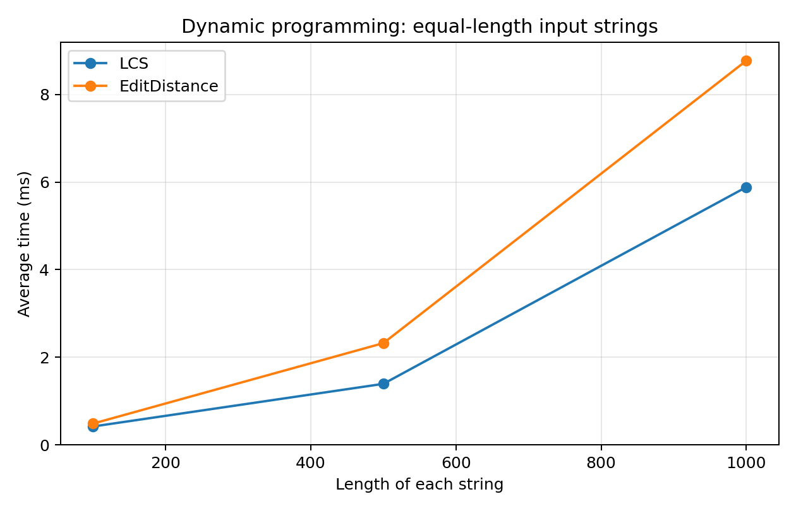
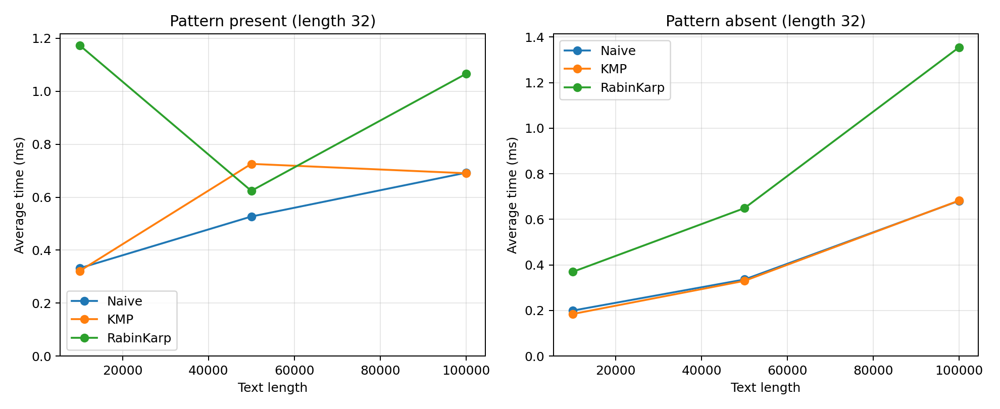
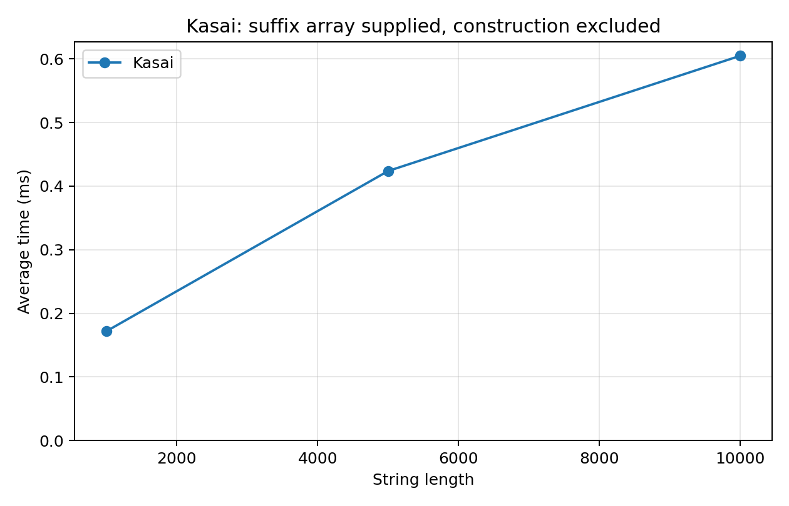

# Assignment 4: Text Analysis

Name: Maussymzhan Makazhan

Group: SE-2527

## Project Overview

This Java 17 project compares dynamic programming and string algorithms:
LCS, Edit Distance, Naive matching, KMP, Rabin-Karp, and Kasai's LCP algorithm.
The examples show their answers, and the benchmark measures their running time.

## How to Run

Install JDK 17 or newer and Maven. Run these commands from this project folder:

```text
mvn clean test
mvn -q exec:java
mvn -q exec:java "-Dexec.args=bench"
python -m pip install -r requirements.txt
python plot_results.py
```

The first command runs the tests. The second prints examples. The third replaces
`results/results.csv` with new measurements. Python is only needed to recreate
the plots. The existing CSV and plots are included in the project.
`mvn clean verify` also builds the JAR and runs the tests.

## Project Structure

```text
src/main/java/kz/aitu/daa/assignment4/
    DynamicProgramming.java   LCS and Edit Distance
    StringMatching.java       Naive, KMP, and Rabin-Karp
    Kasai.java                LCP array from a supplied suffix array
    Benchmark.java            Data generation, timing, and CSV output
    Main.java                 Examples and benchmark entry point
src/test/java/kz/aitu/daa/assignment4/
    DynamicProgrammingTest.java
    StringMatchingTest.java
    KasaiTest.java
results/results.csv
docs/plots/
plot_results.py
.github/workflows/ci.yml
pom.xml
```

## Algorithms and Implementation

### LCS

A subsequence keeps the original order but can skip characters. For example,
`ace` is a subsequence of `abcde`. LCS returns the longest common subsequence's
length, not the subsequence itself.

`dp[i][j]` is the LCS length of the first `i` and first `j` characters.

```text
dp[0][j] = dp[i][0] = 0
If a[i-1] == b[j-1]: dp[i][j] = dp[i-1][j-1] + 1
Otherwise:           dp[i][j] = max(dp[i-1][j], dp[i][j-1])
```

Equal last characters can extend a common subsequence. If they differ, at least
one must be skipped, so I take the better of the two smaller prefix problems.
The table is filled from smaller prefixes to larger ones.

### Edit Distance

Edit Distance returns the minimum number of single-character insertions,
deletions, and substitutions. Each operation costs 1. For example,
`kitten` to `sitting` needs 3 operations.

`dp[i][j]` is the minimum cost of changing the first `i` characters into the
first `j` characters.

```text
dp[i][0] = i, dp[0][j] = j
If a[i-1] == b[j-1]: dp[i][j] = dp[i-1][j-1]
Otherwise: dp[i][j] = 1 + min(dp[i-1][j], dp[i][j-1], dp[i-1][j-1])
```

The three choices are deletion, insertion, and substitution. An optimal edit
sequence ends with one of these choices, so taking the minimum gives the optimal
answer. Empty prefixes need only deletions or insertions.

### String Matching

All three methods return every matching start index in increasing order,
including overlapping occurrences. For `abababa` and `aba`, the answer is
`[0, 2, 4]`.

- Naive tries every valid starting position and compares characters until a
  mismatch or a complete match.
- KMP builds the LPS (Longest Proper Prefix which is also a Suffix) table.
  After a mismatch, it uses LPS to keep a useful part of the matched pattern.
  The text index never moves backwards. Preprocessing also uses these fallbacks.
- Rabin-Karp compares a pattern hash with each window hash. A rolling hash
  removes the outgoing character and adds the incoming character in constant
  time. Equal hashes are checked character by character, so collisions cannot
  produce false matches. The base is 256 and the modulus is 1,000,000,007.
  Hash arithmetic uses `long` to avoid overflowing `int`.

### Kasai's LCP Array

A suffix is the part of a string from a chosen index to the end. A suffix array
lists suffix starting indices in lexicographic order. LCP means Longest Common
Prefix. Here, `lcp[i]` compares suffixes at positions `i-1` and `i` in that array;
`lcp[0]` is 0.

For `banana`, the manually checked example is:

| Suffix index | Suffix | LCP with previous suffix |
| ---: | --- | ---: |
| 5 | a | 0 |
| 3 | ana | 1 |
| 1 | anana | 3 |
| 0 | banana | 0 |
| 4 | na | 0 |
| 2 | nana | 2 |

Kasai first builds inverse ranks, then processes suffixes in text order. After
finding a prefix of length `h`, the next suffix can reuse at least `h-1` matching
characters when `h > 0`. This avoids starting each comparison from zero.
The retained length increases only O(n) times overall and decreases at most
once per iteration, so the complete algorithm is linear.

## Assumptions

Strings are non-null, comparisons are case-sensitive, and indices are zero-based.
Java `char` values are used, so indices and edit operations count UTF-16 code
units. No Unicode normalization is performed.

An empty pattern matches at every boundary, including the end: `abc` gives
`[0, 1, 2, 3]`. Two empty strings give `[0]`. A pattern longer than the text gives
an empty list. Each run keeps its own operation counter.

Kasai expects a correctly sorted suffix array. It checks its length, index range,
and uniqueness, but does not check lexicographic ordering. An empty string and
empty suffix array produce an empty LCP array. No sentinel character is required.

## Complexity Analysis

`n` is the first string or text length, `m` is the second string or pattern
length, and `z` is the number of reported matches. The matching bounds below
assume `1 <= m <= n`. Space excludes the returned occurrence list, which adds O(z).

| Algorithm | Main operation | Preprocessing | Best time | Worst time | Auxiliary space |
| --- | --- | --- | --- | --- | --- |
| LCS | Prefix DP recurrence above | None | O(nm) | O(nm) | O(nm) |
| Edit Distance | Prefix DP recurrence above | None | O(nm) | O(nm) | O(nm) |
| Naive | Compare at each possible start | O(1) | O(n) search | O((n-m+1)m) search | O(1) |
| KMP | LPS fallback after mismatch | O(m) | O(n) search | O(n) search | O(m) |
| Rabin-Karp | Rolling hashes and verification | O(m) | O(n) search | O((n-m+1)m) search | O(1) |
| Kasai | Reuse the previous LCP minus one | O(n) inverse ranks | O(n) total | O(n) total | O(n) |

Both DP algorithms fill all `nm` interior cells, even for identical strings.
The full table has `(n+1)(m+1)` entries, which also describes empty-input cases.
Naive can stop after one comparison per alignment, or compare all `m` characters.
KMP has O(n+m) total time because neither preprocessing nor searching repeatedly
rescans prefixes from the beginning.

Rabin-Karp's usual expected O(n+m) total bound assumes few hash hits. More
precisely, with `h` hash hits, this implementation takes O(n+m+hm), since every
hit is verified. Many collisions or many true overlapping matches can cause
O(nm) time. A fixed hash guarantees correct answers after verification, but does
not guarantee few collisions for every input.

For an empty pattern, all matchers take O(n) time and output space to report
all boundaries. A pattern longer than the text is rejected in O(1) time.

The simple suffix sorter in `Benchmark` is setup code, not Kasai. It compares
suffixes directly and has O(n^2 log n) worst-case time. Its entire construction
is excluded from the Kasai measurements.

## Testing

`mvn clean verify` passed 30 tests with 0 failures and 0 errors.

- LCS: identical, different, empty, repeated, and non-contiguous subsequences.
- Edit Distance: identical and empty strings, insertion, deletion, substitution,
  and combined operations.
- Matching: beginning, middle, end, overlaps, absent and empty patterns, longer
  patterns, empty text, LPS fallback, and a real hash collision. Every search case
  checks all three algorithms against the same expected list. Another 300 fixed-seed
  random cases use Java's `startsWith` as an independent test reference.
- Kasai: the manual `banana` example, empty and single-character inputs,
  repeated characters, invalid arrays, and 100 random cases checked by direct LCP
  comparisons. The suffix sorter is also checked against known arrays.

An additional repeated-prefix test checks that Naive makes 47,550 comparisons
while KMP makes at most 2,000 on a text of length 1,000. Small known examples
also check the operation counters. Library matching is used only in tests.

## Experimental Setup

All generated strings use the alphabet `abcd` and Java `Random` with seed
`42 + n`. LCS and Edit Distance use the same pair at each size. All three
matchers use exactly the same text and pattern in each comparison.

| Task | Required sizes |
| --- | --- |
| LCS and Edit Distance | Two strings of length 100, 500, and 1,000 |
| Matching | Text lengths 10,000, 50,000, and 100,000; pattern length 32 |
| Kasai | String lengths 1,000, 5,000, and 10,000 |

Present patterns are taken from the middle of the text. Absent patterns are
generated with the same alphabet and checked for absence before timing.
Each experiment has 5 warm-up runs followed by exactly 5 timed runs.
`System.nanoTime()` measures each complete algorithm call, including its
preprocessing and allocations. Inputs, suffix arrays, correctness comparisons,
printing, and file writing are outside timed regions. Results are retained to
prevent unused computations from being discarded.

The CSV records the mean time in milliseconds and these operation counts:

- DP: exactly `n*m` updated interior cells, calculated from the table size.
- Matching: actual text-to-pattern character comparisons during the search.
  KMP's LPS comparisons and Rabin-Karp's hash arithmetic are excluded from this
  counter but included in execution time.
- Kasai: actual character comparisons, including mismatches.

These counters measure different operations. For example, Rabin-Karp can make
zero character comparisons for an absent pattern while still updating every
window hash. Fewer counted comparisons do not always mean less execution time.

The recorded run used Windows 11, JDK 17.0.12, and Maven 3.9.9. Timings below
are measured values from one run, not theoretical bounds or a speed guarantee.

## Experimental Results

Average execution times in milliseconds:

| Length of each string | LCS | Edit Distance | DP cells per algorithm |
| ---: | ---: | ---: | ---: |
| 100 | 0.419060 | 0.485080 | 10,000 |
| 500 | 1.392820 | 2.322320 | 250,000 |
| 1,000 | 5.885120 | 8.772560 | 1,000,000 |



| Text length | Pattern | Naive | KMP | Rabin-Karp |
| ---: | --- | ---: | ---: | ---: |
| 10,000 | Present | 0.331700 | 0.321140 | 1.174060 |
| 10,000 | Absent | 0.199520 | 0.184480 | 0.369540 |
| 50,000 | Present | 0.526900 | 0.725840 | 0.623940 |
| 50,000 | Absent | 0.336060 | 0.330040 | 0.649180 |
| 100,000 | Present | 0.692280 | 0.690460 | 1.065880 |
| 100,000 | Absent | 0.681500 | 0.682540 | 1.355380 |



At text length 100,000, search character comparisons were:

| Pattern | Naive | KMP | Rabin-Karp |
| --- | ---: | ---: | ---: |
| Present | 132,913 | 124,673 | 32 |
| Absent | 133,264 | 124,998 | 0 |

| Kasai string length | Average time (ms) | Character comparisons |
| ---: | ---: | ---: |
| 1,000 | 0.171840 | 1,990 |
| 5,000 | 0.423860 | 9,991 |
| 10,000 | 0.605100 | 19,989 |



The complete 27-row dataset is in [results/results.csv](results/results.csv).
Its `result` column stores the LCS length, edit distance, match count, or LCP
array length, depending on the algorithm.

## Discussion

The DP cell counts grow quadratically. Doubling the length from 500 to 1,000
quadruples the cells, and the measured times grow by roughly four times.
Both methods use a full table for clarity; keeping only two rows could reduce
space, but is not used here.

Naive and KMP are close on these random inputs because mismatches usually
happen early. KMP's advantage is its linear worst-case guarantee, illustrated
by the repeated-prefix test. These random experiments do not represent every
possible input structure.

Rabin-Karp makes very few character comparisons here, but modular hash updates
have a cost. It is often slower than Naive and KMP in this run. Matching cannot
stop at the first occurrence because the task requires all indices.

Kasai's comparison counts are close to `2n`, consistent with linear work.
Its reported time excludes suffix sorting, so it is not the time to build
both arrays from scratch.

Some short measurements are not monotonic. For example, the first Rabin-Karp
present case is slower than the 50,000-character case. JIT compilation,
garbage collection, CPU caches, and other system activity affect these small
five-run averages. Operation counts are more stable; these timings alone do
not prove asymptotic complexity.

## Conclusion

LCS measures shared order, while Edit Distance measures the cost of transforming
one string into another. Their DP tables are easy to follow but require quadratic
space. Naive is a useful simple baseline, KMP gives predictable linear searching,
and Rabin-Karp trades direct comparisons for hash calculations and verification.
Kasai builds LCP in linear time when a suffix array is already available.

The GitHub workflow runs `mvn clean verify` on pushes and pull requests.
